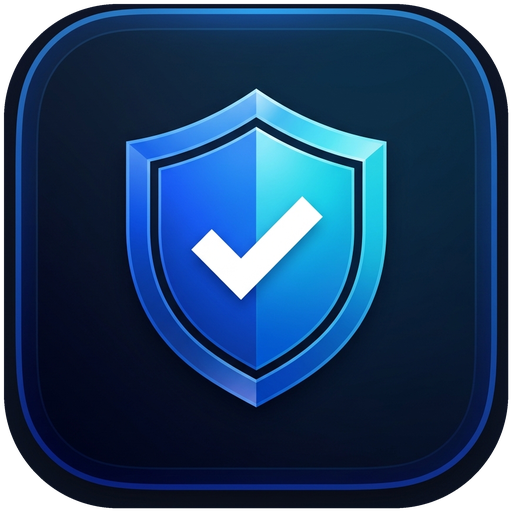

<p align="center">
  
</p>

<h1 align="center">CrackSentinel</h1>

**Defensive malware scanner & download guard for game downloads and cracked-game folders** — built for the classic problem: pirated game folders and web game mirrors are packed with trojanized cracks, fake repack droppers, keyloggers, credential stealers, miners, and RATs wrapped around legitimate emulators (Goldberg, SmartSteam, RUNE, FLT, TENOKE...).

- **Standalone Windows Desktop App (`CrackSentinel.exe`):** Full dark cybersecurity dashboard, zero console window, embedded custom icon, live scan monitor, Quarantine Vault, Real-Time Download Guard, URL Pre-Checker, and persistent history/settings.
- **Live 24/7 Web Scanner & URL Pre-Checker:** `https://sentinel.breakthematrix.id` *(hosted mode with Smart Folder Filter + auto-batching + safe link pre-check)*
- **Pure Go, zero external Go dependencies, no cgo** — builds cleanly for Windows, Linux, and macOS.
- **No-install, read-only design** — never executes, mounts, or modifies scanned targets (the only layer that executes samples is the opt-in network-isolated Docker+wine sandbox).

---

## Quick Start — Install & Run

### 1. 1-Click Windows Install (No Go / Git / Python Required!)
Paste this one-liner in PowerShell — automatically downloads the verified latest **`CrackSentinel.exe`**, installs **7-Zip** + portable **YARA**, and creates a Desktop shortcut:
```powershell
irm https://raw.githubusercontent.com/iAm-182/cracksentinel/main/install.ps1 | iex
```
*(Custom folder, e.g. drive `E:`: `$env:CRACKSENTINEL_DIR="E:\CrackSentinel"; irm https://raw.githubusercontent.com/iAm-182/cracksentinel/main/install.ps1 | iex`)*

### 2. Git Clone + Automatic Setup (`setup.bat`)
```powershell
git clone https://github.com/iAm-182/cracksentinel.git
cd cracksentinel
.\setup.bat
```
`setup.bat` automatically installs missing dependencies (`7-Zip`, portable `yara64.exe` in `tools\`), compiles `CrackSentinel.exe` & `scanner.exe` (or fetches verified release binaries if Go isn't installed), and creates the Desktop shortcut.

### 3. Windows Desktop App — `CrackSentinel.exe` (Best for 20–100+ GB Games)
Double-click **`CrackSentinel.exe`** (or drag & drop a game folder / `.zip` directly onto its icon) to open the standalone CrackSentinel desktop dashboard:
- **Built-in Auto-Updater:** Automatically checks GitHub Releases on startup, verifies **SHA-256** against `checksums.txt`, and performs a safe self-swap + auto-restart without losing your history, quarantine vault, or settings.
- **Dashboard & Quick Scan:** KPI overview, engine health (`YARA 19 rules`, `7-Zip/UnRAR`, `Hash Cache`), and 1-click Quick Scan cards for detected folders (`Downloads`, `Desktop`, `E:\Games`).
- **Live Progress Scanner (0-Copy):** Click **Pilih Folder Game (Scan Langsung)** to scan 50–100 GB game folders straight off disk with live file counter, threat feed, and Cancel button — or Drag & Drop / Mass Check multiple folders at once.
- **Real-Time Download Guard:** Continuously monitors `Downloads`, skips partial downloads (`.crdownload`, `.part`, `.!qB`, `.aria2`, `.tmp`), reads Windows **Mark-of-the-Web** (`Zone.Identifier`) origin URLs, pops Windows desktop toast alerts, and optionally auto-quarantines `MALICIOUS` files.
- **Quarantine Vault:** Inspect isolated threats (original path, SHA-256, score, findings) with 1-click **Restore** or **Permanent Delete**.
- **URL Pre-Check:** Paste a download URL before clicking to trace redirect chains (safe HTTP `HEAD` only), decoy domains, double extensions, and suspiciously tiny repacks.
- **Settings & Persistence:** Configure CPU workers, `E:` temp directory, Quarantine Vault path, VirusTotal / MalwareBazaar API keys, persistent scan history (`data/history.json`), and 1-click Desktop shortcut creation.

*(Alternative launchers: `CrackSentinel-Drop.bat` for direct Explorer drag & drop, or `scanner.exe ui -tmp-dir E:\path\to\tmp`.)*

### 2. Direct Windows Explorer Drag & Drop
Drag **1 file, 1 folder, or multiple game folders** directly onto **`CrackSentinel-Drop.bat`** (works great as a Desktop shortcut). CrackSentinel scans all dropped targets and automatically opens the standalone HTML report.

### 3. Chrome / Edge / Brave Download Guard Extension
Load **`extension/`** unpacked in `chrome://extensions` (or `edge://extensions` with **Developer mode** enabled):
- **Pre-Download Link Guard (24/7):** immediately checks every new download URL & referrer (uses local `127.0.0.1:8787` when running, and automatically falls back to `https://sentinel.breakthematrix.id` 24/7!). Can **auto-pause** downloads flagged `MALICIOUS`.
- **Post-Download Auto-Scan:** automatically sends completed local downloads (including `.zip/.rar/.7z/.iso/.msi`) to local CrackSentinel and shows a desktop notification with the verdict and top finding.

### 4. Online 24/7 Web UI (`https://sentinel.breakthematrix.id`)
Need a quick check on any PC or phone without running anything locally? Open **`https://sentinel.breakthematrix.id`** to drag & drop installers, cracks, scripts, or archives (up to 100 MB) and pre-check suspicious game download URLs.
> In public hosted mode (`-public`), all local-filesystem endpoints (`/api/scan-paths`, `/api/pick`, `/api/quarantine`, `/api/watch/*`, `/api/corpus/label`) are disabled (`403`), URL probing enforces strict **SSRF protection** (blocking loopback, RFC1918 LAN, Tailscale CGNAT `100.64.0.0/10`, and cloud metadata IPs), and uploads/concurrency are strictly capped.

---

## Detection Layers

| Layer | What it catches |
|---|---|
| **Magic-Byte File Classifier** | Checks genuine PE headers (`MZ` + `PE\0\0`) *before* trusting extensions — catches executables masquerading as `.txt`, `.png`, `.pak`, `.nfo` (`masquerading_pe`), OLE2/MSI magic, archive magic, and `.py/.pyw/.rpy` scripts. |
| **PE Static Analysis** | Sections + Shannon entropy, crypter detection (virtual sections with no raw data, multi-MB high-entropy payloads, zero strings), packer detection + **UPX auto-unpack**, manual import table + imphash, .NET/Go detection. |
| **Authenticode Verification** | Pure-Go PKCS#7 + PE Authenticode hash verification (`intact` / `mismatch` / `self_signed` / `expired` / `none`) executed **before** rule matching so tampered or self-signed binaries never get a publisher discount. |
| **Capability vs. Intent Scoring** | Separates *capability* (hooking/network/injection imports — capped so legit tools/emulators don't false-positive) from *intent* (Discord webhooks, Telegram bot tokens, encoded PowerShell, download cradles, wallet/browser credential paths, persistence keys, EICAR). |
| **Crack & Runtime DLL Allowlists** | Known crack emulators (`Goldberg`, `RUNE`, `FLT`, `SmartSteamEmu`, `EMU_STEAMAPI`) and known benign runtimes (`librenpython.dll`, `libwinpthread-1.dll`, `python3*.dll`, `Qt5/6`, `SDL2`, `libcurl`, `vcruntime*`) get capability caps — **strictly vetoed** if any intent/payload IOC or tampering signal is present. |
| **Kind-Aware Rules** | Separate rule sets for scripts (`.bat/.cmd/.ps1/.vbs/.js/.hta/.py/.rpy`), shortcuts (`.lnk/.url/.pif`), Office/PDF documents (macros/DDE), and archives (double extensions, macro docs). |
| **Recursive Container & Decoy Inspection** | Recursively scans inside `.zip` (stdlib), `.7z/.rar/.iso/.cab/.tar/.msi` (`7z` + `UnRAR` fallback), **multi-volume `.rar`** (`.part1.rar` / skips duplicate `.part2+`/`.r00`), and **FreeArc `fg-*.bin`** (when FreeArc CLI is installed), with pre-extraction size budgets. Flags **password-protected archives** (`archive_encrypted`) and **fake web-game decoy templates** (e.g. Ren'Py SDK without `game/` + high-entropy encrypted blob in `data/`, `decoy_renpy_dropper`). |
| **Large-File PE Carving** | Searches oversized game blobs (`data.dat`, `.pak`) at ~400 MB/s for embedded PE images (including overlays) and caches results via fast size/mtime/head+tail fingerprints so re-scans take `<5 ms`. |
| **Mark-of-the-Web (MOTW) & URL Analysis** | Reads Windows NTFS `:Zone.Identifier` ADS to trace which website delivered a file and scores redirect chains, numeric IP-lookalike decoy domains, random risky-TLD domains, abused CDN/paste hosts, double extensions, and suspiciously tiny repack claims. |
| **YARA Layer** | Runs `yara`/`yara64` (Windows & Linux) with embedded base64-encoded builtin rules plus optional external `.yar` directories and self-repairing compilation. |
| **Online & Shared Reputation** | Optional VirusTotal + MalwareBazaar hash lookups (throttled + negative-cached) and opt-in Cloudflare Worker + D1 community hash reputation (`worker/`). |
| **Semantic Adjudication (Optional)** | Optional TypeSafe System One (`-jev`) advisory adjudication with claim validation and JevLab probability calibration (`cmd/calibrate`, `scripts/jevlab_report.py`). |
| **Deep-Dive & Behavioural Sandbox** | Optional REA + Ghidra headless static decompilation (`deep`) and network-isolated Docker + wine + strace detonation (`-detonate`). |

### Verdicts & Score Thresholds
- **`CLEAN`** (`0–29`) — no actionable malware indicators found.
- **`SUSPICIOUS`** (`30–69`) — ambiguous, packed/encrypted crack, password-protected archive, or dual-use utility — review findings before running.
- **`MALICIOUS`** (`70–100`) — strong payload, tampering, decoy dropper, or C2/stealer evidence — quarantine or delete.

---

## CLI Usage

```powershell
# Launch local Drag & Drop Web UI + browser extension bridge
scanner.exe ui [-addr 127.0.0.1:8787] [-tmp-dir E:\tmp] [-watch C:\Users\YOU\Downloads]

# Hosted public web mode (used on Linux homeserver behind Cloudflare Edge)
cracksentinel ui -addr 127.0.0.1:8797 -public -allowed-origin https://sentinel.breakthematrix.id -workers 2 -max-upload-mb 100 -max-concurrent 2

# Scan one folder, one file, or multiple targets at once (mass check)
scanner.exe "D:\Games\Game1" "D:\Games\Game2" "D:\Downloads\crack.zip" -tmp-dir E:\tmp -html report.html

# Real-time download guard (skips partial downloads, MOTW, Windows toast, auto-quarantine)
scanner.exe watch "C:\Users\YOU\Downloads" -interval 5 -toast -quarantine -tmp-dir E:\tmp

# Mass batch scan + human corpus labeling loop
scanner-batch.exe -parent "E:\Games" -tmp-dir E:\tmp -out batch-reports
scanner-label.exe -in batch-reports\disputed.json -corpus corpus.json

# Deep static decompilation (requires REA MCP + Ghidra)
scanner.exe deep "D:\Games\SomeGame\suspicious.exe" -out deep.json

# Measure semantic adjudicator against labelled corpus
go run ./cmd/calibrate -manifest corpus.json -root . -dump calibration.json

# Print build identity
scanner.exe -version
```

Run `scanner.exe -help` for the full flag list.

---

## 24/7 Self-Hosted Architecture (`sentinel.breakthematrix.id`)

CrackSentinel uses a resilient hybrid Cloudflare Edge + Linux HomeServer deployment:

```text
Browser / Extension ──HTTPS──► Cloudflare Worker (edge-worker/, custom domain: sentinel.breakthematrix.id)
                                ├── Static UI served directly from Cloudflare Edge [assets]
                                ├── KV (STATE) holds active HomeServer tunnel origin
                                └── Proxies /api/* ──► HomeServer (Debian Linux systemd)
                                                        ├── cracksentinel.service (127.0.0.1:8797, -public, 7z + YARA)
                                                        └── cracksentinel-tunnel.service (HTTP/2 cloudflared + 1.1.1.1 DoH health probes)
```

Key files:
- [`edge-worker/`](edge-worker/) — Cloudflare Worker + `[assets]` static UI + rate-limited `/_edge-register` & `/edge-health`
- [`scripts/homeserver-tunnel-bridge.py`](scripts/homeserver-tunnel-bridge.py) — self-healing HTTP/2 tunnel bridge daemon using Cloudflare `1.1.1.1` DoH probes

To lock a hosted deployment behind an access key, set `SENTINEL_ACCESS_KEY` (or `-access-key`).

---

## Host Antivirus Note

Because a malware detector contains indicator patterns (`GetAsyncKeyState`, `CryptUnprotectData`, webhook regexes, EICAR), host AV ML classifiers can flag unstripped builds. CrackSentinel mitigates this cleanly:
- Detection indicators in `internal/rules` and `internal/deep` are XOR-obfuscated via `python scripts/obfuscate_indicators.py` (idempotent, verified by tests).
- Built-in YARA rules are embedded base64-encoded (`internal/yara/rules/builtin.yar.b64`).
- Release binaries are built stripped (`-trimpath -ldflags "-s -w"`).
- Code signing & winget packaging helpers live in `scripts/sign.ps1`, `scripts/package.ps1`, `scripts/package.sh`, and `scripts/winget-manifest.ps1`.

---

## Repository Layout

```text
cmd/desktop/            Standalone Windows GUI desktop app (CrackSentinel.exe + embedded icon)
cmd/scanner/            Main CLI (scan, ui, watch, deep subcommands)
cmd/batch/              Mass batch folder scanner + NEEDS A HUMAN disputed queue
cmd/label/              Interactive ground-truth corpus labeling CLI
cmd/calibrate/          Semantic adjudicator calibration harness
assets/                 Application icon master (cracksentinel.png, cracksentinel.ico)
internal/scan/          Walker, worker pool, scoring policy, container expansion, decoy checks
internal/filetype/      Magic-byte-first classifier, disguised PE, archive & multi-volume detection
internal/rules/         Import IOCs, string IOCs, kind-aware rules, evidence classification
internal/known/         Benign game/language runtime DLL allowlist (vetoed by intent IOCs)
internal/pe/            PE sections/entropy, imports, imphash, packer detection, PE carving
internal/authenticode/  Pure-Go PKCS#7 Authenticode verification (intact/mismatch/self-signed)
internal/motw/          Windows Zone.Identifier reader + URL/redirect risk analyzer + SSRF guard
internal/cache/         Versioned JSONL cache (findings, clean verdicts, fast carve fingerprints)
internal/watch/         Real-time download guard (partial-download skip, settle, quarantine, toast)
internal/ui/            Embedded Drag & Drop Web UI + HTTP API + Public/Hosted Mode hardening
internal/yara/          Cross-platform YARA CLI runner + self-repairing compiler
internal/online/        VirusTotal & MalwareBazaar client with throttling & negative caching
internal/jev/           TypeSafe System One semantic adjudication + JevLab calibrator
internal/deep/          REA MCP + Ghidra static deep-dive driver
internal/sandbox/       Docker + wine + strace behavioural detonation
internal/telemetry/     Opt-in shared-reputation client
internal/report/        Console, JSON, Markdown, and standalone offline HTML reports
extension/              Chrome / Edge / Brave Manifest V3 Download Guard extension
edge-worker/            Cloudflare Edge Worker + static assets for 24/7 hosted deployment
worker/                 Cloudflare Worker + D1 shared-reputation backend
scripts/                Obfuscation, packaging, signing, JevLab reporting, and tunnel bridge
docs/                   Architecture & roadmap notes
```

---

## Development & Build

```powershell
# Run indicator obfuscation after changing rules
python scripts/obfuscate_indicators.py

# Format, vet, and test all packages
gofmt -w cmd internal
go vet ./...
go test ./...

# Regenerate icons & Windows PE resource (.syso)
python scripts/gen_desktop_icon.py

# Build Windows binaries (Desktop GUI + CLI tools)
go build -trimpath -ldflags "-s -w -H=windowsgui" -o CrackSentinel.exe ./cmd/desktop
go build -trimpath -ldflags "-s -w" -o scanner.exe ./cmd/scanner
go build -trimpath -ldflags "-s -w" -o scanner-batch.exe ./cmd/batch
go build -trimpath -ldflags "-s -w" -o scanner-label.exe ./cmd/label

# Cross-compile for Linux homeserver (amd64)
$env:GOOS="linux"; $env:GOARCH="amd64"; $env:CGO_ENABLED="0"
go build -trimpath -ldflags "-s -w" -o dist\cracksentinel-linux-amd64 ./cmd/scanner
```

## Defensive Tool Notice

CrackSentinel is strictly a **defensive detector**: it reads, classifies, scores, and reports. No target modification (except explicit opt-in quarantine) and no payload generation.
